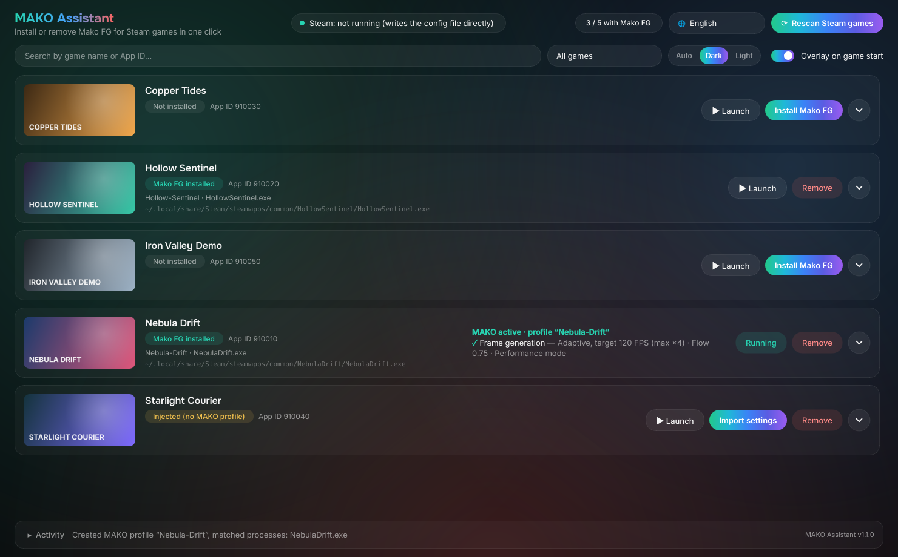
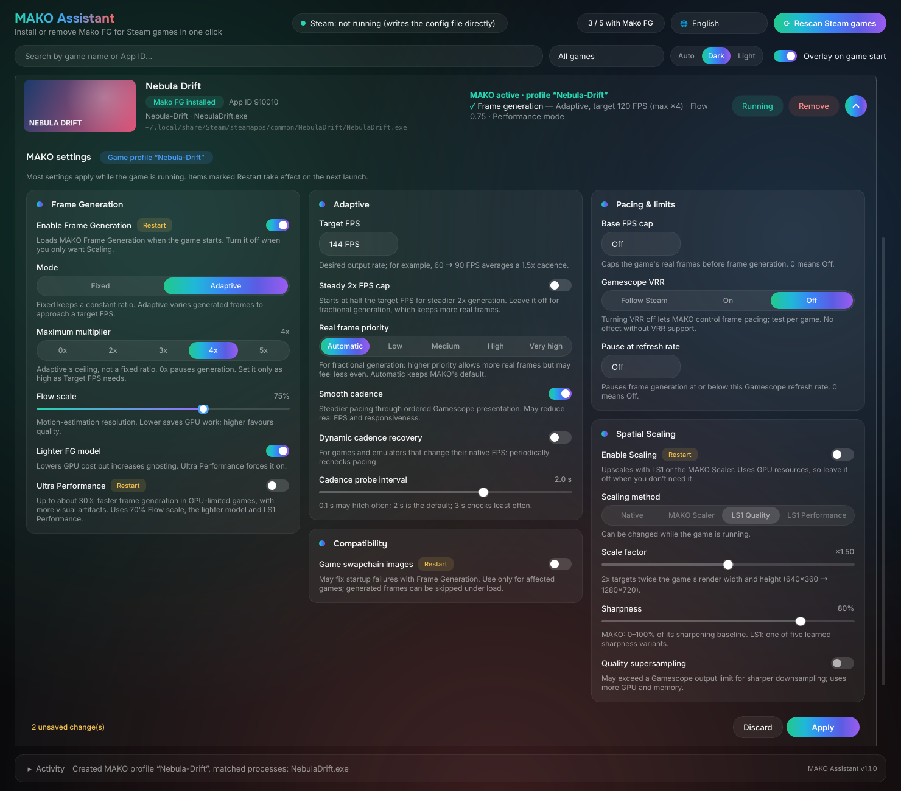
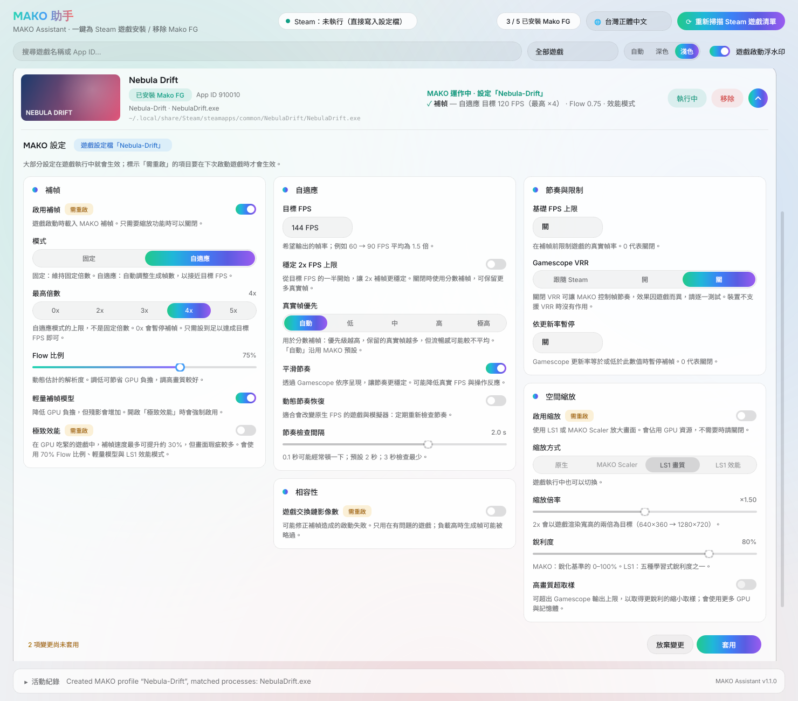
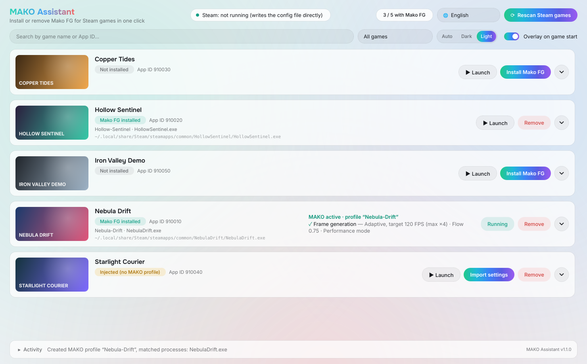
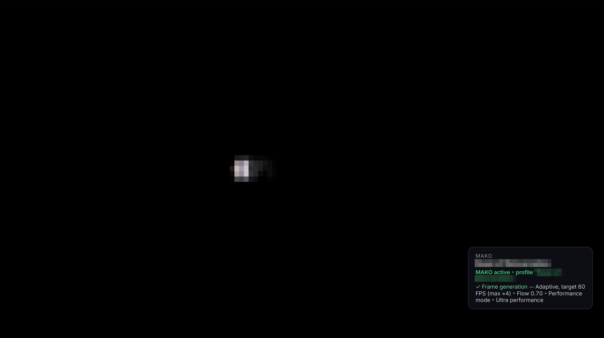

# MAKO Assistant (MAKO 助手)

**English** · [台灣正體中文](#台灣正體中文)

---

## English

A desktop tool (PyQt6) that installs or removes MAKO Renderer frame generation (Mako FG) for Steam games with one click. Built for regular Linux desktops and laptops; on a Steam Deck in Gaming Mode, use MAKO's Decky plugin instead.

> ⚠ **MAKO Assistant does not include MAKO Renderer.** Install MAKO Renderer yourself and open MAKO UI once (this creates the default settings) before using it.

**Download**: the AppImage is on the [Releases](https://github.com/mosesmoon/mako-assistant/releases) page.

**Full feature guide** (12 languages): [English](docs/features/en.md) · [台灣正體中文](docs/features/zh_TW.md) · [简体中文](docs/features/zh_CN.md) · [日本語](docs/features/ja.md) · [Deutsch](docs/features/de.md) · [Français](docs/features/fr.md) · [Español](docs/features/es.md) · [Italiano](docs/features/it.md) · [ไทย](docs/features/th.md) · [Tiếng Việt](docs/features/vi.md) · [Bahasa Melayu](docs/features/ms.md) · [हिन्दी](docs/features/hi.md)

### Screenshots



| | |
|---|---|
| <br>Click the arrow on a game to adjust its MAKO settings, then Apply | <br>Light theme, Traditional Chinese interface |
| <br>Switch between Auto, Dark and Light in the toolbar | <br>Overlay with the active MAKO features when a game starts |

The game list and settings screenshots use sample games and covers. The overlay screenshot is from version 1.0; older screenshots are in [`screenshot/v1.0/`](screenshot/v1.0/).

### Changelog

Multilingual release notes for each version are in [`docs/releases/`](docs/releases/). The build attaches them next to the AppImage (`dist/MAKO_Assistant-<version>-README.md`).

| Version | Date | Summary |
|---|---|---|
| [1.1.0](docs/releases/1.1.0.md) | 2026-10-14 | Per-game MAKO settings panel (expand a game to adjust and apply its MAKO profile); redesigned interface with Auto / Dark / Light themes; layout adapts to narrow windows |
| [1.0.1](docs/releases/1.0.1.md) | 2026-10-03 | Checks that MAKO is installed before installing; fixes the default profile and a game profile matching the same executable; restarts Steam even if applying fails; adds a feature guide in 12 languages |
| 1.0.0 | 2026-10-02 | First release |

### Features

- **Automatic scan**: on first start, scans all Steam libraries (`libraryfolders.vdf` + `appmanifest_*.acf`). Afterwards, click "Rescan Steam games".
- **Install Mako FG**
  - Adds `~/.local/bin/mako-launch %command%` to the Steam launch options, keeping existing environment variables and arguments (for example `FOO=1 %command%` → `FOO=1 ~/.local/bin/mako-launch %command%`).
  - Detects the game's real executable from `appinfo.vdf` (launcher → actual game exe, Unreal `*-Shipping.exe`), creates a game profile in `~/.config/mako-render/conf.toml` using MAKO's default profile (`mako`) as the template, and writes `profile-metadata.json` (`kind: game`, `steam_app_id`) so MAKO UI and Decky both recognise it.
  - If the default profile `mako` also matches this game's executable, it is removed from `mako` so the game uses only its own profile (rescanning fixes existing duplicates too). If another game's profile matches the same executable, you get a warning and nothing is changed automatically.
  - Checks first that MAKO Renderer is installed (`mako-launch` exists) and that MAKO UI has created its settings; if not, nothing is changed.
- **Remove**: only takes `mako-launch` out of the launch options. The game's profile is deleted only if you tick "Also remove the game's MAKO Renderer settings".
- **Automatic path updates**: on every rescan, games that had Mako FG installed through this tool get their executables detected again and `active_in` updated. Matched processes you added by hand in MAKO UI are kept.
- **Launch games**: every row has a "▶ Launch" button (via `steam://rungameid/<AppID>`); while the game runs it shows "Running".
- **Live MAKO features (actual state, not the config file)**: running Steam games are checked every 3 seconds.
  - Games are matched by the process environment variable `SteamAppId`; `/proc/<pid>/maps` confirms that `libmako-render.so` and vkBasalt are really loaded.
  - Reads `~/.config/mako-render/runtime-state/*.json` written by the MAKO layer (applied frame-generation multiplier / adaptive target, Flow, performance mode, scaling method and resolution, pending changes, errors). These files stay behind after a game exits, so only files whose PID is still alive and whose start time (`process_start_ticks`) matches are used.
- **MAKO settings for each game**: click the arrow at the right end of a game to open its MAKO settings (Frame Generation, Adaptive, Pacing & limits, Spatial Scaling, Compatibility — the same options as MAKO UI, each with a short explanation). Changes are collected until you click "Apply", which writes them to that game's own profile in `conf.toml` (checked against MAKO's accepted ranges, then `mako-cli validate`). A multiplier of 0x pauses frame generation (`frame_generation_enabled = false`). Options marked "Restart" take effect the next time the game starts. The default profile `mako` is never changed here.
- **Overlay on game start**: if MAKO Assistant is open when a game starts, as soon as MAKO has started rendering in the game, the active MAKO features appear in the bottom-right corner for about 10 seconds, then fade out (once per launch; games already running before the assistant opened are skipped). If a game with Mako FG installed still has not loaded MAKO after 90 seconds, a warning is shown. The overlay is a separate X11 (XWayland) window so it can sit on top of fullscreen games; it never takes focus and lets mouse clicks through. It can be turned off with the toolbar switch. It does not appear in Steam Deck Gaming Mode (gamescope).
- **Look and themes**: a dark, glassy design whose buttons and switches use a green → cyan → blue → indigo → violet gradient; switch between Auto (follows the system), Dark and Light in the toolbar. The layout adapts to narrow windows, and messages are collected in the collapsible "Activity" area at the bottom.
- **Languages**: 台灣正體中文, 简体中文, English, 日本語, Deutsch, Français, Español, Italiano, ไทย, Tiếng Việt, Bahasa Melayu, हिन्दी. The system language is picked on first start; switch at the top right (applies immediately and is remembered). Qt's built-in texts (right-click menus and so on) are translated for the first 7 languages; Qt has no official Thai, Vietnamese, Malay or Hindi translations, so right-click menus are in English for those.

### How launch options are written

Steam reads `localconfig.vdf` only when it starts and overwrites it when it exits, so:

| Steam state | Write method |
|---|---|
| Not running | Edits `userdata/<id>/config/localconfig.vdf` directly (backed up first as `.mako-assistant.bak`) |
| Running, CEF debugging port available (opened by Decky Loader) | Applies live through `SteamClient.Apps.SetAppLaunchOptions` |
| Running, but no connection | Asks whether to close Steam → applies → reopens Steam |

`conf.toml` is backed up as `conf.toml.mako-assistant.bak` before writing, checked with `mako-cli validate` afterwards, and restored automatically if validation fails.

### Install and run

**AppImage (recommended)**: Python and Qt are included, so nothing else needs to be installed.

1. Download `MAKO_Assistant-<version>-x86_64.AppImage` from the [Releases](https://github.com/mosesmoon/mako-assistant/releases) page.
2. Make it executable: right-click the file → Properties → Permissions, and turn on "Allow executing file as program" (the wording varies by file manager).
3. Double-click it to open MAKO Assistant.

Or in a terminal:

```bash
chmod +x MAKO_Assistant-*-x86_64.AppImage
./MAKO_Assistant-*-x86_64.AppImage
```

If it does not start, your system may be missing FUSE; run it with `./MAKO_Assistant-*-x86_64.AppImage --appimage-extract-and-run` instead.

**From source**: requires Python 3.11+ and PyQt6 (Arch: `sudo pacman -S python-pyqt6`).

```bash
./mako-assistant    # run from the source folder
./install.sh        # or install to ~/.local/share/mako-assistant and add a menu entry
```

The tool's own state (managed games, game list cache, language, theme) is stored in `~/.config/mako-assistant/state.json`.

### For developers

Build the AppImage yourself (outputs `dist/MAKO_Assistant-<version>-x86_64.AppImage` and its release notes):

```bash
./build-appimage.sh
```

The AppImage bundles a portable CPython 3.13 (uv / python-build-standalone) and a trimmed PyQt6, so the target machine needs neither Python nor Qt. Building needs `uv` and network access (PyQt6 wheel and appimagetool downloads).

Run the tests:

```bash
python3 -m unittest discover -s tests -v
```

---

## 台灣正體中文

為 Steam 遊戲一鍵安裝 / 移除 MAKO Renderer 補幀（Mako FG）的桌面工具（PyQt6）。專為一般 Linux 桌面電腦與筆電設計；Steam Deck 遊戲模式下請改用 MAKO 的 Decky 外掛。

> ⚠ **MAKO 助手不包含 MAKO Renderer。** 使用前請先自行安裝 MAKO Renderer，並開啟一次 MAKO UI（會建立預設設定）。

**下載**：AppImage 請到 [Releases](https://github.com/mosesmoon/mako-assistant/releases) 頁面下載。

**完整功能介紹**（12 種語言）：[English](docs/features/en.md) · [台灣正體中文](docs/features/zh_TW.md) · [简体中文](docs/features/zh_CN.md) · [日本語](docs/features/ja.md) · [Deutsch](docs/features/de.md) · [Français](docs/features/fr.md) · [Español](docs/features/es.md) · [Italiano](docs/features/it.md) · [ไทย](docs/features/th.md) · [Tiếng Việt](docs/features/vi.md) · [Bahasa Melayu](docs/features/ms.md) · [हिन्दी](docs/features/hi.md)

### 截圖


| | |
|---|---|
| <br>按遊戲右側的箭頭調整 MAKO 設定，再按「套用」 | <br>淺色主題、台灣正體中文介面 |
| <br>在工具列切換自動、深色、淺色主題 | <br>遊戲啟動時顯示目前啟用的 MAKO 功能 |

遊戲清單與設定畫面的截圖使用範例遊戲與封面；浮水印截圖為 1.0 版。舊版截圖在 [`screenshot/v1.0/`](screenshot/v1.0/)。

### 更新紀錄

各版本的多語言更新說明在 [`docs/releases/`](docs/releases/)，打包時會自動附在 AppImage 旁（`dist/MAKO_Assistant-<版本>-README.md`）。

| 版本 | 日期 | 摘要 |
|---|---|---|
| [1.1.0](docs/releases/1.1.0.md) | 2026-10-14 | 新增每款遊戲的 MAKO 設定面板（展開遊戲即可調整並套用到它的 MAKO profile）；介面全新設計，支援自動 / 深色 / 淺色主題；視窗較窄時版面會自動調整 |
| [1.0.1](docs/releases/1.0.1.md) | 2026-10-03 | 安裝前先檢查 MAKO 是否已安裝；修正預設 profile 與遊戲 profile 重複比對；套用失敗時也會重開 Steam；新增 12 語系功能介紹 |
| 1.0.0 | 2026-10-02 | 首次發布 |

### 功能

- **自動掃描**：第一次開啟時自動掃描所有 Steam 遊戲庫（`libraryfolders.vdf` + `appmanifest_*.acf`），之後可按「重新掃描 Steam 遊戲清單」。
- **安裝 Mako FG**
  - 在 Steam 啟動選項注入 `~/.local/bin/mako-launch %command%`（保留原有的環境變數與參數，例如 `FOO=1 %command%` → `FOO=1 ~/.local/bin/mako-launch %command%`）。
  - 從 `appinfo.vdf` 偵測遊戲實際執行檔（含啟動器→真正的遊戲 exe、Unreal `*-Shipping.exe`），以 MAKO 預設 profile（`mako`）為範本，在 `~/.config/mako-render/conf.toml` 建立遊戲 profile，並寫入 `profile-metadata.json`（`kind: game`、`steam_app_id`），MAKO UI / Decky 都能辨識。
  - 若預設 profile `mako` 的比對程式也包含這個遊戲的執行檔，會從 `mako` 移除，讓遊戲只套用自己的 profile（重新掃描時也會修正既有的重複）。若其他遊戲的 profile 也比對到同一個執行檔，只會提示、不自動修改。
  - 會先確認 MAKO Renderer 已安裝（`mako-launch` 存在）且 MAKO UI 已建立設定；不符合就不做任何修改。
- **移除**：只從啟動選項移除 `mako-launch`；勾選「一併移除 MAKO Renderer 遊戲設定」才會刪除該遊戲的 profile。
- **自動更新遊戲路徑**：每次重新掃描時，對「透過本工具安裝過 Mako FG」的遊戲重新偵測執行檔，更新 `active_in`；使用者在 MAKO UI 手動加入的比對程式會保留。
- **啟動遊戲**：遊戲列表每一列都有「▶ 啟動」按鈕（透過 `steam://rungameid/<AppID>`），遊戲執行中會顯示「執行中」。
- **執行中的 MAKO 功能（實際狀態，非設定檔）**：每 3 秒偵測一次執行中的 Steam 遊戲：
  - 以程序環境變數 `SteamAppId` 對應遊戲；以 `/proc/<pid>/maps` 確認 `libmako-render.so`、vkBasalt 真的被載入。
  - 讀取 MAKO 圖層寫出的 `~/.config/mako-render/runtime-state/*.json`（套用中的補幀倍數 / 自適應目標、Flow、效能模式、縮放方式與解析度、待套用變更、錯誤）。這些檔案在遊戲結束後會殘留，所以只採用 PID 仍存活且啟動時間（`process_start_ticks`）相符的檔案。
- **每款遊戲的 MAKO 設定**：按遊戲最右側的箭頭即可展開它的 MAKO 設定（補幀、自適應、節奏與限制、空間縮放、相容性，和 MAKO UI 相同，每項都附簡短說明）。變更會先暫存，按「套用」才寫入這款遊戲在 `conf.toml` 中自己的 profile（先檢查是否在 MAKO 接受的範圍內，再以 `mako-cli validate` 驗證）。倍數設為 0x 會暫停補幀（`frame_generation_enabled = false`）。標示「需重啟」的項目在下次啟動遊戲時生效。預設 profile `mako` 不會在這裡被修改。
- **遊戲啟動浮水印**：MAKO 助手開著時啟動遊戲，一偵測到 MAKO 已在遊戲中建立畫面，就在右下角顯示執行中的 MAKO 功能約 10 秒後淡出（每次啟動只顯示一次；開啟助手前就在跑的遊戲不顯示）。已裝 Mako FG 的遊戲若 90 秒後仍未載入 MAKO，會顯示警告。浮水印用獨立的 X11（XWayland）視窗，才能疊在全螢幕遊戲上，且不搶焦點、滑鼠可穿透；可在工具列的開關關閉。Steam Deck 遊戲模式（gamescope）下不會顯示。
- **外觀與主題**：深色玻璃質感設計，按鈕與開關採用綠、青、藍、靛、紫漸層；可在工具列切換自動（跟隨系統）、深色、淺色主題。視窗較窄時版面會自動調整，訊息集中在底部可展開收起的「活動紀錄」區。
- **多國語言**：台灣正體中文、简体中文、English、日本語、Deutsch、Français、Español、Italiano、ไทย、Tiếng Việt、Bahasa Melayu、हिन्दी。首次依系統語系自動選擇，可在右上角切換（即時生效並記住）。Qt 內建文字（右鍵選單等）在前 7 種語言也會翻譯；Qt 官方沒有泰、越、馬來、印地語翻譯，這幾種語言的右鍵選單會是英文。

### 啟動選項的寫入方式

Steam 只在啟動時讀取 `localconfig.vdf`，並在關閉時覆寫它，因此：

| Steam 狀態 | 寫入方式 |
|---|---|
| 未執行 | 直接修改 `userdata/<id>/config/localconfig.vdf`（先備份為 `.mako-assistant.bak`） |
| 執行中且 CEF 除錯埠可用（Decky Loader 會開啟） | 透過 `SteamClient.Apps.SetAppLaunchOptions` 即時套用 |
| 執行中但無法連線 | 詢問是否關閉 Steam → 套用 → 重新開啟 Steam |

寫入 `conf.toml` 前會備份為 `conf.toml.mako-assistant.bak`，寫入後以 `mako-cli validate` 驗證，失敗會自動還原。

### 安裝與執行

**AppImage（建議）**：已內含 Python 與 Qt，不需另外安裝。

1. 到 [Releases](https://github.com/mosesmoon/mako-assistant/releases) 頁面下載 `MAKO_Assistant-<版本>-x86_64.AppImage`。
2. 設為可執行：對檔案按右鍵 →「內容」→「權限」，勾選「允許作為程式執行」（各檔案管理員的用詞略有不同）。
3. 點兩下即可開啟 MAKO 助手。

也可以在終端機執行：

```bash
chmod +x MAKO_Assistant-*-x86_64.AppImage
./MAKO_Assistant-*-x86_64.AppImage
```

如果無法開啟，可能是系統缺少 FUSE，可改用 `./MAKO_Assistant-*-x86_64.AppImage --appimage-extract-and-run` 執行。

**從原始碼執行**：需要 Python 3.11 以上和 PyQt6（Arch：`sudo pacman -S python-pyqt6`）。

```bash
./mako-assistant    # 在原始碼目錄直接執行
./install.sh        # 或安裝到 ~/.local/share/mako-assistant，並建立選單項目
```

本工具的狀態（已管理的遊戲、遊戲清單快取、語言、主題）存在 `~/.config/mako-assistant/state.json`。

### 開發者

自行打包 AppImage（輸出 `dist/MAKO_Assistant-<版本>-x86_64.AppImage` 與該版本的更新說明）：

```bash
./build-appimage.sh
```

AppImage 內含可攜式 CPython 3.13（uv / python-build-standalone）與精簡過的 PyQt6，目標機器不需安裝 Python 或 Qt。建置需要 `uv` 與網路（下載 PyQt6 wheel 與 appimagetool）。

執行測試：

```bash
python3 -m unittest discover -s tests -v
```
